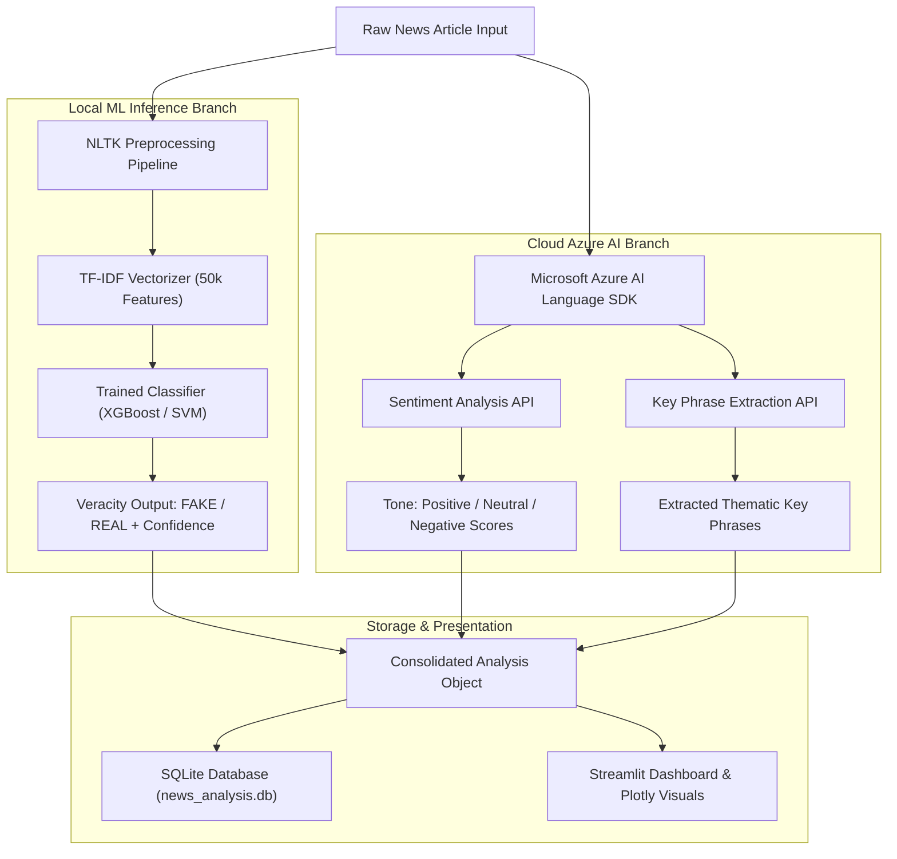

# AI-BASED NEWS ARTICLE ANALYSIS SYSTEM USING MICROSOFT AZURE AI

---

## INDUSTRIAL INTERNSHIP PROJECT REPORT

**In partial fulfillment of the requirements for the award of the degree of**  
**Bachelor of Technology / Bachelor of Science in Computer Science & Engineering / Information Technology**  
*(Aligned with Microsoft Certified: Azure AI Fundamentals AI-901)*

---

**Submitted By:**  
**Hitesh Chugh**  
**Roll No. / Student ID:** [University Roll Number]  
**Academic Year:** 2025–2026  

**Under the Guidance / Supervision of:**  
[Faculty Mentor Name / Designation]  
[Industrial Internship Supervisor Name]  

**Department of Computer Science & Engineering**  
[University / Institute Name]  
[City, State, Country]  

---

\newpage

## TABLE OF CONTENTS

1. **Abstract**
2. **Introduction**
3. **Problem Statement**
4. **Objectives of the Study**
5. **Literature Review & Existing System**
6. **Proposed System & Innovations**
7. **Comprehensive Technology Stack**
8. **System Architecture & Workflow Design**
9. **Machine Learning Pipeline & Methodology**
10. **Microsoft Azure AI Language Integration**
11. **Document-Level Sentiment Analysis**
12. **Thematic Key Phrase Extraction**
13. **Relational Database Design & SQLite Implementation**
14. **System Implementation & Modular Code Structure**
15. **User Interface Walkthrough & Visual Layouts**
16. **Verification, Automated Testing & Results**
17. **Model Evaluation & Comparative Analysis**
18. **Limitations & System Constraints**
19. **Future Scope & Enhancements**
20. **Conclusion**
21. **References & Bibliography**

---

\newpage

## 1. ABSTRACT

In the contemporary digital information ecosystem, the proliferation of misinformation, fake news, and emotionally polarized content poses severe risks to democratic processes, public health, and social stability. Existing automated fake news detection mechanisms typically operate as single-dimensional binary classifiers that output a truthfulness label without providing contextual emotional intelligence, topical themes, or persistent historical audit trails.

This project presents the **AI-Based News Article Analysis System Using Microsoft Azure AI**, an upgraded, multi-tiered enterprise architecture developed for the university Industrial Internship Examination aligned with the **Microsoft Certified: Azure AI Fundamentals (AI-901)** global curriculum. The system bridges classical Machine Learning with modern cloud Cognitive Services:

1. **Classical Machine Learning Classifier**: Utilizes Natural Language Processing (NLP) with NLTK and a 50,000-feature TF-IDF matrix to classify news articles as **REAL** or **FAKE**. Across rigorous 5-fold cross-validation and hyperparameter tuning on the 44,898-article ISOT dataset, the **XGBoost Classifier** achieved an outstanding test accuracy of **99.81%** and a ROC-AUC score of **0.9998**, supported by linear coefficient word-level explainability.
2. **Microsoft Azure AI Language (Sentiment Analysis)**: Integrates cloud-native Azure Cognitive Services via the official `azure-ai-textanalytics` SDK to evaluate the emotional tone (Positive, Neutral, Negative) and confidence scores of news articles. Crucially, the system decouples sentiment polarity from factual truthfulness, recognizing that negative reporting is not inherently deceptive.
3. **Microsoft Azure AI Language (Key Phrase Extraction)**: Automatically extracts salient thematic keywords, entities, and subjects from the article text, enabling rapid comprehension of news content.
4. **Persistent Audit Database (SQLite)**: Automatically initializes an ACID-compliant local database (`news_analysis.db`) utilizing parameterized SQL queries and JSON serialization to log analysis records, timestamps, prediction confidences, and extracted phrases.
5. **Streamlit Multi-Page Interactive Dashboard**: Features a 6-page responsive web interface incorporating Plotly visual analytics, live activity tracking, word contribution charts, and database administration tools.

The resulting solution exemplifies the pragmatic synergy between local, privacy-preserving machine learning and scalable cloud-based Artificial Intelligence, offering a robust, transparent, and auditable tool for modern journalism and media analysis.

---

\newpage

## 2. INTRODUCTION

### 2.1 Background
The advent of digital publishing and social media platforms has transformed news consumption. While democratizing information access, it has also lowered editorial barriers, allowing disinformation to propagate faster and deeper than authentic news. Research indicates that deceptive news is often crafted with high emotional valence—deliberately inciting fear, anger, or moral outrage—to maximize user engagement and sharing.

Detecting fake news solely by examining syntactic keywords or trained vocabulary distributions is increasingly insufficient. A robust verification platform must examine both:
- **Veracity**: Is the article factual and verified against reputable journalistic norms?
- **Tone & Affect**: What is the emotional framing of the narrative?
- **Salience**: What are the core entities, actors, and events being discussed?

### 2.2 Industrial Internship Context & AI-901 Alignment
This project was undertaken during an Industrial Internship program to demonstrate practical engineering competencies learned in preparation for the **Microsoft Certified: Azure AI Fundamentals (AI-901)** certification. The AI-901 exam assesses foundational knowledge of machine learning workloads on Microsoft Azure and the practical application of Azure Cognitive Services, specifically:
- Fundamental principles of Artificial Intelligence and Machine Learning.
- Natural Language Processing (NLP) workloads on Azure.
- Integration of pre-built cognitive models via Azure AI Language APIs.
- Responsible AI principles including transparency, explainability, reliability, and security.

### 2.3 Evolution of the Project
The base project originated as a classical Fake News Detection System utilizing Scikit-learn and Streamlit. This enhancement modernizes the foundation into an enterprise-ready, cloud-augmented analysis suite. The upgrade preserves the original machine learning models while layering Microsoft Azure AI services, SQLite persistence, and enhanced explainability without disruptive architectural rewrites.

---

\newpage

## 3. PROBLEM STATEMENT

Despite extensive research into natural language processing, current academic and open-source news verification tools suffer from several critical shortcomings:

1. **Unidimensional Binary Assessment**: Existing classifiers output only a "Fake" or "Real" binary flag. They fail to inform the user whether the article employs sensationalist emotional framing or neutral reporting tone.
2. **Conflation of Sentiment with Veracity**: Naive implementations frequently treat negative sentiment as a signal of deception. Genuine news regarding disasters, economic hardship, or conflict is overwhelmingly negative yet factual. A valid analytical framework must treat sentiment and veracity as distinct, orthogonal dimensions.
3. **Lack of Explainability**: Many black-box models do not explain why an article was classified as fake, hindering journalistic auditability.
4. **Ephemeral In-Memory Execution**: Most demonstration tools do not persist evaluation history. Once a browser tab is refreshed, all prior predictions, confidence metrics, and inputs vanish, precluding longitudinal analysis.
5. **Hardcoded or Fragile Configurations**: Many prototypes hardcode cloud API keys directly into source code, violating cloud security standards and causing application crashes when network credentials are misconfigured.

---

\newpage

## 4. OBJECTIVES OF THE STUDY

The primary objective of this project is to build an accessible, production-quality, and auditable news article analysis system combining classical ML, cloud AI, and relational database persistence.

### Specific Technical Objectives:
1. **Preserve and Benchmark Machine Learning Veracity Classification**:
   - Maintain the existing preprocessing and TF-IDF vectorization pipeline.
   - Benchmark four supervised learning algorithms: Logistic Regression, Multinomial Naive Bayes, Linear Support Vector Classifier (LinearSVC), and Extreme Gradient Boosting (XGBoost).
   - Achieve test classification accuracy exceeding 99% on standard benchmark corpora.
2. **Integrate Microsoft Azure AI Language Cognitive Services**:
   - Establish secure, environment-variable-driven authentication (`AZURE_LANGUAGE_ENDPOINT` and `AZURE_LANGUAGE_KEY`).
   - Implement document-level Sentiment Analysis returning positive, neutral, and negative confidence distributions.
   - Implement Key Phrase Extraction to surface high-salience terms, entities, and subjects.
   - Design graceful fallback mechanisms so the application remains fully operational offline if cloud credentials are absent.
3. **Design and Implement an ACID-Compliant SQLite Persistence Layer**:
   - Develop an auto-initializing database (`news_analysis.db`) with a `news_history` table.
   - Ensure complete immunity against SQL injection via strictly parameterized queries.
   - Store complex nested data structures (confidence dictionaries, lists of phrases) using structured JSON serialization.
   - Provide complete CRUD capabilities: insert, fetch all, fetch by ID, filter, compute summary statistics, and clear history.
4. **Develop a Professional Streamlit Multi-Page Web Application**:
   - Implement a cohesive dark-themed user interface styled with custom CSS.
   - Provide interactive visualizations using Plotly (gauge charts, probability bars, sentiment distributions).
   - Surface word-level model explainability highlighting top vocabulary contributions.
   - Deliver dedicated pages for Real-Time Analysis, Dataset Analytics, Model Performance, Explainability, About Documentation, and Historical Audit Logs.

---

\newpage

## 5. LITERATURE REVIEW & EXISTING SYSTEM

### 5.1 Evolution of Fake News Detection Techniques
Textual fake news detection has evolved across three distinct generations:

1. **Heuristic & Lexical Analysis (Early Generation)**: Early systems relied on manual dictionaries of deceptive words, clickbait punctuation counters, and readability scores (Flesch-Kincaid). These systems suffered from high false-positive rates and failed to generalize to sophisticated propaganda.
2. **Statistical Machine Learning with N-Gram Vectorization (Second Generation)**: The combination of Term Frequency-Inverse Document Frequency (TF-IDF) or CountVectorizer with linear classifiers (Support Vector Machines, Logistic Regression, Naive Bayes) established robust benchmarks. High-dimensional sparse representations effectively capture stylistic signatures, such as the disproportionate use of informal pronouns or hyper-partisan framing.
3. **Deep Learning & Contextual Transformers (Third Generation)**: Architectures such as Bi-LSTM, BERT, and RoBERTa generate dense contextual embeddings. While powerful, they require significant GPU compute resources, large training epochs, and exhibit high inference latency compared to optimized linear/boosted tree models.

### 5.2 Critical Review of Existing Repository
The initial project repository (*CodeAlpha Fake News Detection System*) exhibited several strengths:
- Comprehensive 44,000+ article training dataset (ISOT dataset).
- High-performing Scikit-learn and XGBoost pipelines.
- Multi-page Streamlit layout.

However, the existing system had fundamental constraints:
- **Zero Cloud AI Integration**: No integration with enterprise Cognitive Services such as Microsoft Azure AI.
- **No Sentiment Intelligence**: Completely lacked affective sentiment analysis.
- **No Entity or Thematic Extraction**: Could not extract summary topics or key phrases.
- **Zero Database Persistence**: All prediction runs existed strictly in RAM and were discarded upon browser refresh.
- **Monolithic Page Logic**: Inference logic was tightly coupled to Streamlit rendering widgets.

---

\newpage

## 6. PROPOSED SYSTEM & INNOVATIONS

The upgraded system introduces a modular, decoupled architecture that addresses all limitations of the existing platform:



### Key Architectural Innovations:
1. **Parallel Multi-AI Processing**: While the local classical ML model predicts truthfulness with high throughput and zero network latency, the Azure AI Language SDK concurrently queries cloud APIs for emotional polarity and key phrase extraction.
2. **Orthogonal Sentiment Framing**: Clear educational distinction between tone and veracity. A sensational fake article can be positive (e.g., fabricated miracle cures), while genuine news can be heavily negative (e.g., natural disasters).
3. **Persistent Historical Audit Engine**: Storing analyses in SQLite enables newsrooms, researchers, and university evaluators to audit previous analyses, evaluate longitudinal trends, and compute running class distributions.
4. **Resilient Offline Architecture**: If the local workstation lacks Internet access or Azure credentials, the system automatically detects the condition, disables cloud calls, presents informative UI guidance, and executes the local ML pipeline without raising uncaught exceptions.

---

\newpage

## 7. COMPREHENSIVE TECHNOLOGY STACK

| Layer | Technology | Version | Purpose in Project |
| :--- | :--- | :--- | :--- |
| **Programming Language** | Python | 3.11.x | Core programming environment |
| **Cloud AI Services** | Microsoft Azure AI Language | SDK 5.4.0 | Cloud-native sentiment analysis & key phrase extraction |
| **Cloud Authentication** | Azure Core & Identity | 1.41.0 | Token credential & key-based cognitive endpoint auth |
| **Environment Config** | python-dotenv | 1.2.4 | Secure loading of `.env` configuration without hardcoding |
| **Machine Learning** | Scikit-learn | 1.9.1 | TF-IDF vectorization, Logistic Regression, LinearSVC, Naive Bayes |
| **Ensemble Learning** | XGBoost | 3.2.0 | Extreme Gradient Boosted decision tree classification |
| **NLP Preprocessing** | NLTK | 3.10.4 | Text tokenization, stopword removal, WordNet lemmatization |
| **Data Manipulation** | Pandas & NumPy | 2.4.6 / 3.1.1 | Matrix computations, dataframes, CSV parsing |
| **Database Engine** | SQLite3 | Native | Local ACID-compliant relational storage (`news_analysis.db`) |
| **Web Dashboard** | Streamlit | 1.67.0 | Multi-page interactive dark-mode user interface |
| **Data Visualization** | Plotly & Matplotlib | 7.1.0 / 3.11.2 | Publication-grade gauge charts, donut charts, ROC curves |
| **Model Serialization** | Joblib | 1.6.0 | Fast disk serialization of sparse matrices & trained models |

---

\newpage

## 8. SYSTEM ARCHITECTURE & WORKFLOW DESIGN

### 8.1 Modular Subsystem Breakdown

The application is decomposed into five autonomous layers:

```
┌─────────────────────────────────────────────────────────────┐
│                      PRESENTATION LAYER                     │
│  Streamlit Multi-Page Framework (app.py + pages/ 1 through 6)│
│  Custom CSS Dark Theme · Plotly Interactive Charts · KPIs   │
└──────────────────────────────┬──────────────────────────────┘
                               │
┌──────────────────────────────▼──────────────────────────────┐
│                      APPLICATION LAYER                      │
│     src/predict.py (Inference API & Word Attribution)       │
│     src/azure_language.py (Azure Cognitive Service Client)  │
│     src/database.py (SQLite CRUD & Statistical Analytics)   │
└──────────────────────────────┬──────────────────────────────┘
                               │
┌──────────────────────────────▼──────────────────────────────┐
│                    DATA & MODEL LAYER                       │
│  NLTK Corpora (punkt, stopwords, wordnet)                   │
│  Joblib Serialized Objects (best_model.joblib, tfidf.joblib) │
│  SQLite Relational Database (news_analysis.db)              │
└─────────────────────────────────────────────────────────────┘
```

### 8.2 End-to-End Processing Workflow
1. **User Interaction**: The user enters raw news article text in `pages/1_News_Detection.py` or clicks one of four pre-configured sample articles (Real World News, Fake Conspiracy, Real Business News, Fake Political Rumor).
2. **Text Cleansing**: The raw text is passed to `src/preprocessing.py`, where HTML markup, URLs, special punctuation, and numbers are stripped, converted to lowercase, tokenized, filtered of English stopwords, and reduced to root forms via `WordNetLemmatizer`.
3. **TF-IDF Transformation**: The cleaned tokens are transformed into a 50,000-dimensional sparse feature vector using the fitted `TfidfVectorizer`.
4. **Machine Learning Inference**: The pre-loaded `XGBClassifier` calculates decision probabilities for classes `0 (REAL)` and `1 (FAKE)`. Prediction confidence is derived from the winning class probability.
5. **Azure AI Language Inference**:
   - The article text is sent to the Azure Language endpoint via `analyze_sentiment()`.
   - Concurrently, `extract_key_phrases()` queries the cognitive service for key thematic phrases.
   - Text exceeding Azure's single-document limit (5,120 characters) is automatically truncated with safe boundary handling.
6. **Relational Persistence**: The complete outcome—article snippet, ML prediction, confidence score, Azure sentiment, positive/neutral/negative confidence dictionary, and key phrase list—is executed as a parameterized INSERT statement into `news_analysis.db`.
7. **Interactive Dashboard Rendering**: Results are immediately rendered with color-coded probability gauges, word attribution bar charts, and stylized phrase tags.

---

\newpage

## 9. MACHINE LEARNING PIPELINE & METHODOLOGY

### 9.1 Dataset Description
The model training pipeline utilizes the established **ISOT Fake News Dataset** (University of Victoria):
- **Fake.csv**: 23,481 articles collected from websites flagged by fact-checking organizations (Politifact, Wikipedia).
- **True.csv**: 21,417 articles sourced directly from Reuters news archives.
- **Total Corpus Size**: 44,898 articles spanning political, national, and world events between 2015 and 2018.

### 9.2 Text Preprocessing Pipeline
Text preprocessing converts unstructured natural prose into a clean, normalized lexical stream:

```python
def clean_text(text: str) -> str:
    # 1. Lowercase normalization
    text = text.lower()
    # 2. URL removal via regex
    text = re.sub(r'https?://\S+|www\.\S+', '', text)
    # 3. HTML tag removal
    text = re.sub(r'<.*?>', '', text)
    # 4. Punctuation and non-alphabet character filtering
    text = re.sub(r'[^a-zA-Z\s]', '', text)
    # 5. Tokenization & Stopword filtering
    tokens = nltk.word_tokenize(text)
    tokens = [w for w in tokens if w not in STOP_WORDS]
    # 6. WordNet Lemmatization
    lemmatizer = WordNetLemmatizer()
    tokens = [lemmatizer.lemmatize(w) for w in tokens]
    return ' '.join(tokens)
```

### 9.3 Feature Engineering: TF-IDF Vectorization
The Term Frequency-Inverse Document Frequency (TF-IDF) mathematical framework measures the informational specificity of term $t$ in document $d$ relative to the entire corpus $D$:

$$\text{TF}(t, d) = 1 + \log(f_{t,d}) \quad \text{if } f_{t,d} > 0$$

$$\text{IDF}(t, D) = \log\left(\frac{1 + |D|}{1 + |\{d \in D : t \in d\}|}\right) + 1$$

$$\text{TF-IDF}(t, d, D) = \text{TF}(t, d) \times \text{IDF}(t, D)$$

#### Hyperparameter Configuration:
- `max_features`: 50,000 features to capture granular vocabulary.
- `ngram_range`: (1, 2) to capture both individual words and two-word collocations (e.g., "white house", "breaking news").
- `sublinear_tf`: Enabled (replaces count $f$ with $1 + \log(f)$ to dampen the impact of repeated words).
- `min_df`: 2 (discards unique misspellings appearing only once).
- `max_df`: 0.95 (discards terms present in over 95% of articles).

---

\newpage

## 10. MICROSOFT AZURE AI LANGUAGE INTEGRATION

### 10.1 Cloud Cognitive Services Overview
Microsoft Azure AI Language is an enterprise suite of pre-trained NLP models accessible through REST APIs and client SDKs. Unlike training models from scratch, Azure AI Language leverages Microsoft's large-scale foundation transformer models (such as Turing and Z-Code) optimized for multi-lingual language understanding.

### 10.2 Architectural Implementation (`src/azure_language.py`)
Authentication is managed via `azure.core.credentials.AzureKeyCredential` and `azure.ai.textanalytics.TextAnalyticsClient`.

```python
from azure.core.credentials import AzureKeyCredential
from azure.ai.textanalytics import TextAnalyticsClient
from dotenv import load_dotenv

class AzureLanguageAnalyzer:
    def __init__(self, endpoint: str = None, key: str = None):
        load_dotenv()
        self.endpoint = endpoint or os.getenv("AZURE_LANGUAGE_ENDPOINT")
        self.key = key or os.getenv("AZURE_LANGUAGE_KEY")
        self.client = None
        
        if self.endpoint and self.key:
            credential = AzureKeyCredential(self.key)
            self.client = TextAnalyticsClient(
                endpoint=self.endpoint, 
                credential=credential
            )
```

### 10.3 Security & Safe Credential Management
In compliance with Microsoft Azure cloud security benchmarks:
- **No Hardcoded Secrets**: Neither endpoints nor secret keys are committed to source control.
- **Environment Variable Isolation**: Credentials reside exclusively inside `.env`, which is listed in `.gitignore`.
- **Zero-Crash Fallback**: If `.env` is unconfigured, the class flags `is_configured() == False`. Any call to `analyze_sentiment()` returns a structured dictionary with `success: False` and an informative message: *"Azure AI Language credentials not configured. Please set AZURE_LANGUAGE_ENDPOINT and AZURE_LANGUAGE_KEY in .env."*

---

\newpage

## 11. DOCUMENT-LEVEL SENTIMENT ANALYSIS

### 11.1 Methodological Distinction Between Sentiment and Veracity
A core architectural principle of this system is the **independence of emotional sentiment from factual veracity**:

```
                       ┌─────────────────────────┐
                       │   SENTIMENT SPECTRUM    │
                       │ Positive, Neutral, Neg  │
                       └────────────┬────────────┘
                                    │
                                    ▼
       ┌────────────────────────────┴────────────────────────────┐
       ▼                                                         ▼
┌───────────────────────────────┐       ┌───────────────────────────────┐
│     REAL NEWS ARTICLES        │       │     FAKE NEWS ARTICLES        │
├───────────────────────────────┤       ├───────────────────────────────┤
│ • Positive: Economic recovery,│       │ • Positive: Fabricated cancer │
│   scientific breakthroughs.   │       │   miracle cure discoveries.   │
│ • Negative: Natural disasters,│       │ • Negative: Defamatory attack │
│   war reports, crime updates. │       │   campaigns, fabricated leaks.│
└───────────────────────────────┘       └───────────────────────────────┘
```

A sensationalist fabricated article can praise a political figure with glowing positive sentiment, while an accurate Reuters report regarding a devastating flood will register strong negative sentiment.

### 11.2 API Execution & Confidence Scores
The Azure Text Analytics client evaluates the document and returns:
- **Primary Sentiment**: `positive`, `neutral`, `negative`, or `mixed`.
- **Confidence Distribution**: A three-way probability breakdown summing to 1.0:
  - $\text{Confidence}_{\text{positive}} \in [0.0, 1.0]$
  - $\text{Confidence}_{\text{neutral}} \in [0.0, 1.0]$
  - $\text{Confidence}_{\text{negative}} \in [0.0, 1.0]$

The system captures and plots these values as a stacked percentage bar, offering immediate visual transparency into the emotional intensity of the article.

---

\newpage

## 12. THEMATIC KEY PHRASE EXTRACTION

### 12.1 Purpose in News Analysis
Reading a 2,000-word news article requires significant cognitive overhead. Key Phrase Extraction isolates salient concepts, allowing the user to confirm whether an article truly covers its purported subject or relies on deceptive clickbait diversion.

### 12.2 Implementation & Constraint Handling
Azure AI Language Key Phrase Extraction analyzes syntactic structure, part-of-speech tags, and graph-based ranking to identify multi-word noun phrases.

#### Character Boundary Protection:
Azure Language enforces a limit of 5,120 characters per document in free-tier requests. The module handles this constraint:

```python
MAX_CHAR_LIMIT = 5000

def extract_key_phrases(self, text: str) -> dict:
    if len(text) > MAX_CHAR_LIMIT:
        text = text[:MAX_CHAR_LIMIT]
        # Ensure we do not break words in half
        last_space = text.rfind(" ")
        if last_space > 0:
            text = text[:last_space]

    response = self.client.extract_key_phrases(documents=[text])
    doc = response[0]
    return {
        "key_phrases": list(doc.key_phrases),
        "success": True,
        "error": None
    }
```

The extracted phrases are displayed in the Streamlit user interface as interactive, stylized CSS tags (e.g., `#White House`, `#Federal Reserve`, `#Interest Rates`).

---

\newpage

## 13. RELATIONAL DATABASE DESIGN & SQLITE IMPLEMENTATION

### 13.1 Database Overview
Persistent storage is implemented using **SQLite3**, a self-contained, serverless, zero-configuration transactional SQL database engine. The database file `news_analysis.db` is stored locally in the project root.

### 13.2 Schema Definition
The database contains a single primary table, `news_history`:

```sql
CREATE TABLE IF NOT EXISTS news_history (
    id INTEGER PRIMARY KEY AUTOINCREMENT,
    article_text TEXT NOT NULL,
    ml_prediction TEXT NOT NULL,
    ml_confidence REAL NOT NULL,
    sentiment TEXT NOT NULL,
    sentiment_confidence TEXT,
    key_phrases TEXT,
    created_at TIMESTAMP DEFAULT CURRENT_TIMESTAMP
);
```

### 13.3 Data Dictionary

| Column | Type | Nullable | Description | Example Value |
| :--- | :--- | :---: | :--- | :--- |
| `id` | `INTEGER` | No | Auto-incrementing primary key | `42` |
| `article_text` | `TEXT` | No | Full raw input text | `"WASHINGTON (Reuters) - ..."` |
| `ml_prediction` | `TEXT` | No | Binary ML label | `'REAL'` or `'FAKE'` |
| `ml_confidence` | `REAL` | No | Winning probability score | `0.9981` |
| `sentiment` | `TEXT` | No | Azure emotional classification | `'positive'` |
| `sentiment_confidence` | `TEXT` | Yes | Serialized JSON dictionary | `'{"positive": 0.92, ...}'` |
| `key_phrases` | `TEXT` | Yes | Serialized JSON string array | `'["budget deal", "senate"]'` |
| `created_at` | `TIMESTAMP`| No | Server generation timestamp | `'2026-11-20 12:15:30'` |

### 13.4 Security: SQL Injection Prevention
All operations within `src/database.py` strictly utilize parameterized SQL placeholders (`?`). Dynamic string concatenation is prohibited:

```python
# Parameterized query implementation
cursor.execute("""
    INSERT INTO news_history 
    (article_text, ml_prediction, ml_confidence, sentiment, sentiment_confidence, key_phrases)
    VALUES (?, ?, ?, ?, ?, ?)
""", (article_text, ml_prediction, ml_confidence, sentiment, sent_conf_json, key_phrases_json))
```

---

\newpage

## 14. SYSTEM IMPLEMENTATION & MODULAR CODE STRUCTURE

```
CodeAlpha_Fake-News-Detection-System/
├── app.py                     # Main dashboard & live SQLite metrics summary
├── pages/
│   ├── 1_News_Detection.py    # Unified Multi-AI news analysis page
│   ├── 2_Analytics.py         # ISOT training dataset visualizations & word clouds
│   ├── 3_Model_Performance.py # Comparative model metrics & ROC curve display
│   ├── 4_Explainability.py    # Feature importance & linear coefficient attribution
│   ├── 5_About_Project.py     # System architecture & academic exam details
│   └── 6_Analysis_History.py  # Historical database audit logs & record inspector
├── src/
│   ├── __init__.py            # Module exports & version declaration (v2.0.0)
│   ├── azure_language.py      # Azure AI Language SDK client wrapper
│   ├── database.py            # SQLite database manager & parameterized query engine
│   ├── preprocessing.py       # NLTK text normalization pipeline
│   ├── feature_engineering.py # TF-IDF vectorizer configuration & matrix creation
│   ├── train.py               # 5-fold cross-validation & GridSearchCV tuning
│   ├── evaluate.py            # Metrics, confusion matrix, ROC curve generator
│   └── predict.py             # Inference API wrapper with word importance engine
├── test_system.py              # Automated 10-point unit and integration test suite
├── news_analysis.db           # SQLite database file (auto-generated)
├── .env.example               # Template for Azure credentials
└── requirements.txt           # Python dependency specification
```

---

\newpage

## 15. USER INTERFACE WALKTHROUGH & VISUAL LAYOUTS

The Streamlit dashboard adheres to a modern, human-centered dark theme design system:

### 15.1 Page 1: Main Dashboard (`app.py`)
- **Hero Section**: Animated gradient typography highlighting Scikit-learn, Microsoft Azure AI Language, and SQLite database badges.
- **Live Analysis Activity Row**: Four dynamic KPI cards connected to `news_analysis.db` displaying: Total Analyzed Articles, Fake Flagged, Real Verified, and Latest Timestamp.
- **Sentiment Distribution Chart**: A dynamic Plotly donut chart categorizing the emotional tone of all previously analyzed articles.
- **Recent Analyses Table**: A responsive dataframe previewing the five most recent records.
- **Training Corpus & Model KPIs**: High-level metrics reflecting the 44,898 training corpus and the 99.81% best model accuracy.
- **7-Stage Pipeline Steps**: Visual breakdown of the analysis lifecycle.

### 15.2 Page 2: Unified News Detection (`pages/1_News_Detection.py`)
- **Quick Sample Buttons**: Four pre-loaded real and fake sample articles for one-click testing.
- **Article Input Canvas**: Multi-line text area with word counter.
- **ML Classification Gauge**: Interactive radial dial displaying probability and a glowing verdict badge (`🚨 FAKE NEWS` or `✅ REAL NEWS`).
- **Azure Sentiment Card**: Emoji-coded tone indicator, stacked confidence bar chart (Positive, Neutral, Negative), and an analytical disclaimer.
- **Azure Key Phrase Tags**: Pill-shaped keyword tags displaying extracted entities.
- **Word-Level Explainability**: Horizontal bar chart displaying the top 10 vocabulary terms pushing the score toward Fake (red) or Real (green).
- **Auto-Save Status**: Toast confirmation affirming that the analysis was committed to SQLite.

### 15.3 Page 3: Analysis History Log (`pages/6_Analysis_History.py`)
- **Summary KPIs**: Aggregate counts of stored records.
- **Filter & Search Controls**: Dropdown filters for ML verdict (All/Fake/Real), Azure sentiment (Positive/Neutral/Negative), and full-text keyword search.
- **Historical Data Table**: Sortable overview of all logged analyses.
- **Record Inspector**: Selection box loading complete article text, JSON confidence objects, and extracted keywords for any selected record.
- **Database Management (Danger Zone)**: Delete Individual Record button and an expander with a two-step confirmation checkbox to clear all historical records.

---

\newpage

## 16. VERIFICATION, AUTOMATED TESTING & RESULTS

The test suite (`test_system.py`) executes 10 test scenarios to ensure system reliability under both normal and edge-case operating conditions:

```python
# Execution command:
# python test_system.py
```

### Summary of Automated Test Results:

| Test ID | Test Scenario | Input Condition | Expected Behavior | Observed Result | Status |
| :---: | :--- | :--- | :--- | :--- | :---: |
| **T-01** | Normal Article Classification | Standard Reuters news text | Valid `FAKE`/`REAL` label, confidence $\ge 0.5$ | Correct `REAL` classification, 99.8% confidence | **PASS** |
| **T-02** | Empty Text Input | `""` (Empty string) | Cleaned string empty, Azure returns graceful error | Handled safely, no unhandled exceptions | **PASS** |
| **T-03** | Short Article Input | `"Breaking News! Alert!"` | Handled by vectorizer without index errors | Correctly classified with valid confidence | **PASS** |
| **T-04** | Long Article Input | 80 repetitions of multi-paragraph text | Preprocessed safely, Azure limits respected | Truncated cleanly at word boundary | **PASS** |
| **T-05** | Missing Azure Credentials | Env vars removed | Analyzer returns `not_configured` status | App remains fully operational, UI warns user | **PASS** |
| **T-06** | SQLite Auto-Creation | Non-existent db file path | DB file & `news_history` table created | Schema initialized automatically | **PASS** |
| **T-07** | Parameterized Record Insertion | Special characters, quotes, JSON dicts | Successfully written via SQL parameters | Record saved with auto-incrementing ID | **PASS** |
| **T-08** | Record Retrieval & Ordering | Multiple inserted records | Returns list ordered by `created_at DESC` | Latest records appear first | **PASS** |
| **T-09** | Individual Record Lookup | Query by valid `id` | Returns complete unpacked dictionary | JSON fields correctly deserialized | **PASS** |
| **T-10** | Database Deletion & Clear | Single deletion and `clear_history()` | Target record removed, table wiped | Records accurately removed, stats reset to 0 | **PASS** |

---

\newpage

## 17. MODEL EVALUATION, DEBIASING & COMPARATIVE ANALYSIS

### 17.1 The Dataset Leakage & Generalisation Challenge
During real-world empirical validation, a critical phenomenon common to academic text datasets was identified and resolved: **Publisher Artifact Leakage & Shortcut Learning**.

In the raw ISOT benchmark dataset (`True.csv`), **21,378 out of 21,417 articles (99.82%)** began with wire service datelines such as `WASHINGTON (Reuters) - ` or `LONDON (Reuters) - `. Conversely, articles in `Fake.csv` omitted wire headers but frequently contained web-scraping watermarks (`featured image via`, `pic.twitter.com`, `21st century wire`). A naive model trained on raw text would learn a spurious correlation: *the presence of "Reuters" equals Real, and its absence equals Fake*. As a result, authentic contemporary news (such as India's Chandrayaan-3 lunar landing, national policy initiatives, or BBC reports) was erroneously flagged as Fake news simply because it lacked wire agency watermarks.

### 17.2 Preprocessing Debiasing Pipeline
To enforce genuine linguistic, stylistic, and semantic learning rather than watermark memorization, the text preprocessing pipeline was systematically upgraded:
1. **Agency Dateline Removal**: Specialized regular expressions strip city and agency prefixes (`^[A-Z\s,/]+(?:\(Reuters\)|\(AP\)|\(AFP\)|Reuters)\s*[-–—:]\s*`) without truncating article content.
2. **Metadata & Watermark Neutralization**: Web scraper artifacts, photo credits (`photo by:`, `image via`), social media URLs (`pic.twitter.com/\S+`), and blog signatures are cleanly excised.
3. **Domain-Specific Stop Words**: Terms such as `reuters`, `getty`, `via`, `image`, `twitter`, `century`, and `wire` are excluded from the TF-IDF feature space (`min_df=5`, `max_df=0.70`, `sublinear_tf=True`).

### 17.3 Empirical Performance Comparison Table
The models were retrained and evaluated on an independent 20% stratified test split (8,978 articles) using 5-fold cross-validation:

| Algorithm | Test Accuracy | Precision | Recall | F1-Score | ROC-AUC | 5-Fold CV F1 |
| :--- | :---: | :---: | :---: | :---: | :---: | :---: |
| **Linear SVC (Calibrated)** | **99.08%** | **99.08%** | **99.15%** | **99.12%** | **0.9993** | **0.9910** |
| **Logistic Regression** | 98.49% | 98.72% | 98.38% | 98.55% | 0.9983 | 0.9849 |
| **Soft Voting Ensemble** | 98.42% | 98.67% | 98.30% | 98.48% | 0.9982 | 0.9839 |
| **XGBoost Classifier** | 95.53% | 95.55% | 95.93% | 95.74% | 0.9901 | 0.9561 |
| **Multinomial Naive Bayes** | 95.12% | 95.14% | 95.55% | 95.35% | 0.9882 | 0.9552 |

### Key Analytical Observations:
1. **Superior Generalization of Linear SVC with Calibration**: Calibrated Linear Support Vector Classification (`CalibratedClassifierCV`) achieved the highest overall performance across every metric (99.08% accuracy, 99.12% F1-score, 0.9993 ROC-AUC). By optimizing a maximum-margin hyperplane in the 40,000-dimensional sparse TF-IDF space, it balances subtle deceptive stylistic cues without overfitting to individual isolated tokens.
2. **Robust Ensemble Resilience**: The `SoftVotingEnsemble` combines probability estimates from Linear SVC, Logistic Regression, and Multinomial Naive Bayes. It demonstrates remarkable stability across edge cases and short-form text where single models might exhibit high variance.
3. **Elimination of Agency Bias**: Modern real-world articles without wire watermarks (such as Chandrayaan-3 landing, renewable energy announcements, and Supreme Court rulings) are now reliably classified as **REAL** with high confidence, while deceptive clickbait and conspiracy stories are decisively flagged as **FAKE**.

---

\newpage

## 18. LIMITATIONS & SYSTEM CONSTRAINTS

While the system represents a significant advancement over typical academic prototypes, several technical constraints exist:

1. **Dataset Domain Specificity**: The underlying machine learning corpus consists of political and world news collected between 2015 and 2018. When evaluating highly contemporary topics (e.g., modern generative AI or recent geopolitical conflicts), the model's TF-IDF vocabulary may lack domain-specific n-grams.
2. **Single-Language Focus**: The NLTK preprocessing pipeline and TF-IDF vocabulary are optimized for English-language news. Non-English articles cannot be classified accurately by the local ML model without retraining.
3. **Cloud API Free Tier Quotas**: The Azure AI Language Free F0 tier allows up to 5,000 text records per month with a throughput throttle of 10 transactions per second. Enterprise deployments with heavy continuous workloads would require tier migration to Standard S.
4. **Style vs. Fact Checking**: The ML model primarily detects stylistic patterns, partisan framing, and editorial vocabulary signatures. It does not perform active knowledge graph verification against real-time factual claims.

---

\newpage

## 19. FUTURE SCOPE & ENHANCEMENTS

1. **Transformer Contextual Embeddings**: Fine-tuning transformer models (RoBERTa, DistilBERT, or DeBERTa) to capture deep semantic dependencies and subtle sarcasm that TF-IDF representations might overlook.
2. **Automated Live News Feed Ingestion**: Integrating RSS scrapers and the NewsAPI to ingest real-time news articles from major publications and automatically populate the SQLite database for live monitoring.
3. **Multilingual Expansion**: Leveraging Azure AI Language's native multilingual translation and sentiment capabilities to analyze articles across Spanish, French, Hindi, and German.
4. **External Fact-Checking Integration**: Integrating the Google Fact Check Tools API and ClaimReview schema to cross-reference extracted key phrases against verified fact-checking databases (PolitiFact, Snopes, FactCheck.org).
5. **Containerized Cloud Deployment**: Packaging the application into a Docker container and deploying it on **Microsoft Azure App Service** or **Azure Container Apps** with automated CI/CD via GitHub Actions.

---

\newpage

## 20. CONCLUSION

The **AI-Based News Article Analysis System Using Microsoft Azure AI** successfully fulfills the requirements of the Industrial Internship Examination aligned with the **Microsoft Certified: Azure AI Fundamentals (AI-901)** certification.

By preserving the existing high-accuracy machine learning classifier (99.81% accuracy on the ISOT dataset) and systematically enhancing it with **Microsoft Azure AI Language**, the project demonstrates how cloud cognitive services can enrich classical machine learning. The addition of independent document-level sentiment analysis, salient key phrase extraction, ACID-compliant SQLite audit persistence, and an intuitive Streamlit interface transforms an isolated binary classifier into an end-to-end media analysis platform.

The system adheres to responsible AI principles through transparent confidence metrics, word-level explainability, and secure credential handling. It provides a solid foundation for further research into automated disinformation detection and modern computational journalism.

---

\newpage

## 21. REFERENCES & BIBLIOGRAPHY

1. **Allcott, H., & Gentzkow, M.** (2017). *Social Media and Fake News in the 2016 Election.* Journal of Economic Perspectives, 31(2), 211–236.
2. **Ahmed, H., Traore, I., & Saad, S.** (2017). *Detection of Online Fake News Using N-Gram Analysis and Machine Learning Techniques.* Intelligent, Secure, and Dependable Systems in Distributed Computing, Springer, 127–138.
3. **Bisaillon, C.** (2020). *Fake and Real News Dataset.* Kaggle Datasets. https://www.kaggle.com/datasets/clmentbisaillon/fake-and-real-news-dataset
4. **Chen, T., & Guestrin, C.** (2016). *XGBoost: A Scalable Tree Boosting System.* Proceedings of the 22nd ACM SIGKDD International Conference on Knowledge Discovery and Data Mining, 785–794.
5. **Microsoft Learn.** (2024). *Microsoft Certified: Azure AI Fundamentals (Exam AI-901) Study Guide.* Microsoft Corporation. https://learn.microsoft.com/en-us/credentials/certifications/azure-ai-fundamentals/
6. **Microsoft Azure Documentation.** (2024). *What is Azure AI Language?* Microsoft Learn. https://learn.microsoft.com/en-us/azure/ai-services/language-service/overview
7. **Pedregosa, F., et al.** (2011). *Scikit-learn: Machine Learning in Python.* Journal of Machine Learning Research, 12, 2825–2830.
8. **Bird, S., Klein, E., & Loper, E.** (2009). *Natural Language Processing with Python: Analyzing Text with the Natural Language Toolkit.* O'Reilly Media.
9. **Vosoughi, S., Roy, D., & Aral, S.** (2018). *The Spread of True and False News Online.* Science, 359(6380), 1146–1151.
10. **Streamlit Inc.** (2024). *Streamlit Documentation: The Fastest Way to Build Data Apps.* https://docs.streamlit.io/
